# Markmap MCP Server

[](https://mcptoplist.com/server/glama%2Fjinzcdev%2Fmarkmap-mcp-server)



[](https://www.npmjs.com/package/@jinzcdev/markmap-mcp-server)
[](https://www.npmjs.com/package/@jinzcdev/markmap-mcp-server)
[](LICENSE)
[](README_zh-CN.md)
[](https://github.com/jinzcdev/markmap-mcp-server)

Markmap MCP Server is based on the [Model Context Protocol (MCP)](https://modelcontextprotocol.io/introduction). It converts Markdown into interactive mind maps using [markmap](https://github.com/markmap/markmap), and can optionally export **PNG / JPG / SVG on the server** for Agent-friendly delivery. Generation runs **locally** — no third-party API keys required.

## Features

- **Markdown → Mind Map**: Convert Markdown (headings + nested lists) to interactive HTML mind maps
- **Agent-friendly returns**: Return a file path, inline HTML, and/or image content (configured at startup)
- **Server-side export**: Export PNG / JPG / SVG via Playwright for chat/inline preview
- **Browser preview**: Configurable open behavior — always, never, or agent-decided (startup setting)
- **Browser export toolbar**: When viewing HTML, also export PNG/JPG/SVG or copy Markdown in the page UI
- **Offline HTML**: Startup `--offline` inlines assets so the page works without CDN access
- **File workflows**: Read from `inputPath`, list recent outputs, clean up old files
- **Privacy-first**: Fully local conversion; no cloud mind-map API

## Prerequisites

1. Node.js **v20 or above**
2. For **server-side image export** (`format: png|jpg|svg`): install Playwright and Chromium

```bash
npm install playwright
npx playwright install chromium
```

(`playwright` is an optional dependency of this package.)

## Installation

```bash
# Install from npm
npm install @jinzcdev/markmap-mcp-server -g

# Basic run
npx -y @jinzcdev/markmap-mcp-server

# Specify output directory and auto-open in browser
npx -y @jinzcdev/markmap-mcp-server --output /path/to/output/directory --open always
```

### Docker

```bash
docker build -t markmap-mcp-server .
docker run --rm -i \
  -v /path/to/output:/data/markmap \
  -e MARKMAP_DIR=/data/markmap \
  markmap-mcp-server
```

Or clone and run locally:

```bash
git clone https://github.com/jinzcdev/markmap-mcp-server.git
cd markmap-mcp-server
npm install && npm run build
# Optional: enable server-side image export
npx playwright install chromium
node build/index.js
```

## Usage

Add the following configuration to your MCP client (Cursor / Claude Desktop / etc.):

```json
{
  "mcpServers": {
    "markmap": {
      "type": "stdio",
      "command": "npx",
      "args": ["-y", "@jinzcdev/markmap-mcp-server"],
      "env": {
        "MARKMAP_DIR": "/path/to/output/directory",
        "MARKMAP_OPEN": "never",
        "MARKMAP_RETURN_MODE": "path"
      }
    }
  }
}
```

### Server preferences (CLI / env)

These are decided when the server starts — **not** tool arguments:

| Preference       | CLI               | Env                   | Values                                                    | Default          |
| ---------------- | ----------------- | --------------------- | --------------------------------------------------------- | ---------------- |
| Output directory | `--output` / `-o` | `MARKMAP_DIR`         | any directory path                                        | `~/.markmap-mcp` |
| Open in browser  | `--open [mode]`   | `MARKMAP_OPEN`        | `always` \| `never` \| `agent` (bare `--open` = `always`) | `never`          |
| Return mode      | `--return-mode`   | `MARKMAP_RETURN_MODE` | `path` \| `content` \| `both`                             | `path`           |
| Offline HTML     | `--offline`       | `MARKMAP_OFFLINE`     | `true` \| `false` (CLI: pass `--offline` to enable)       | `false`          |

CLI flags override environment variables. `--output` overrides `MARKMAP_DIR`.

**`--open`:** bare `--open` means `always`. You may also pass `--open always|never|agent`. An invalid value exits with an error. Without the flag, `MARKMAP_OPEN` is used (default `never`).

**Return mode:**

| Mode      | Meaning                                                                 |
| --------- | ----------------------------------------------------------------------- |
| `path`    | Paths JSON only (`htmlFilePath` + `filePath`)                           |
| `content` | Inline content only (raw HTML text, or a base64 image block) — no paths |
| `both`    | Paths JSON plus inline content                                          |

Generated HTML always includes the markmap toolbar, English export labels, and fully expanded nodes.

### Example prompts

- “Summarize this design doc as a mind map.”
- “Convert `./notes/architecture.md` to a mind map.”
- “Generate a PNG mind map of this outline for the chat.”

## Available Tools

### `markdown_to_mindmap`

Convert Markdown into an interactive mind map (and optionally an image).

| Parameter   | Type                              | Default | Description                                                                                                                       |
| ----------- | --------------------------------- | ------- | --------------------------------------------------------------------------------------------------------------------------------- |
| `markdown`  | string                            | —       | Markdown content (required unless `inputPath` is set). Wins when both are provided.                                               |
| `inputPath` | string                            | —       | Absolute path to a local `.md` file                                                                                               |
| `format`    | `html` \| `png` \| `svg` \| `jpg` | `html`  | Output format. Image formats need Playwright                                                                                      |
| `filename`  | string                            | auto    | Output base name (sanitized; prefixed with `markmap-` if needed; reusing overwrites)                                              |
| `open`      | boolean                           | `false` | Whether to open the result in browser. **Only exposed when server open mode is `agent`** (`--open agent` / `MARKMAP_OPEN=agent`). |

**Return (`returnMode=path`):**

```json
{
  "htmlFilePath": "/path/to/markmap-….html",
  "filePath": "/path/to/markmap-….html"
}
```

For image formats, `filePath` is the image path and `htmlFilePath` is still the HTML source.

**Return (`returnMode=content`):** Raw HTML text block, or an MCP `image` content block (base64) for png/jpg/svg — no paths JSON. Oversized HTML (≥200KB) falls back to paths JSON.

**Return (`returnMode=both`):** Paths JSON plus the inline content above.

> **Note:** Interactive zoom/collapse and the in-page “Export PNG/JPG/SVG” buttons are part of the **HTML viewer**. Server-side `format: png|jpg|svg` is what Agents can consume directly without a manual browser click.

### `list_mindmaps`

List recent generated files in the output directory (newest first). Only files whose names start with `markmap` are included.

| Parameter | Type   | Default | Description                 |
| --------- | ------ | ------- | --------------------------- |
| `limit`   | number | `20`    | Max files to return (1–200) |

Returns `{outputDir, files: [{name, filePath, size, mtimeMs, mtime}]}`.

### `get_mindmap`

Retrieve a generated mind map file by its absolute path. Path must stay inside the configured output directory (path traversal denied).

| Parameter  | Type   | Default | Description                                        |
| ---------- | ------ | ------- | -------------------------------------------------- |
| `filePath` | string | —       | Absolute path to the mind map file (HTML or image) |

Returns JSON `{filePath, mimeType, size}`. For HTML/SVG under 200KB, also appends a text content block. PNG/JPG return metadata only (no image block) — re-export via `markdown_to_mindmap` with `format=png\|jpg` if pixels are needed.

### `cleanup_mindmaps`

Delete old (or all) generated mind map files.

| Parameter    | Type    | Default | Description                            |
| ------------ | ------- | ------- | -------------------------------------- |
| `maxAgeDays` | number  | `7`     | Delete files older than this many days |
| `all`        | boolean | `false` | If true, delete all markmap files      |
| `dryRun`     | boolean | `false` | If true, preview without deleting      |

### Prompt: `mindmap_from_content`

Helper prompt that asks the model to structure notes as Markdown, then call `markdown_to_mindmap`.

| Parameter | Type   | Default | Description                             |
| --------- | ------ | ------- | --------------------------------------- |
| `topic`   | string | —       | Topic or raw notes to organize as a map |

## Related Projects

| Project                                                                         | Description                                                                        |
| ------------------------------------------------------------------------------- | ---------------------------------------------------------------------------------- |
| **[MarkXMind Online](https://github.com/jinzcdev/markxmind)**                   | Create XMind mind maps with Markdown online. [Try it →](https://markxmind.js.org/) |
| **[Obsidian MarkXMind Plugin](https://github.com/jinzcdev/obsidian-markxmind)** | Render XMindMark syntax as XMind mind maps inside Obsidian.                        |

## License

This project is licensed under the [MIT](./LICENSE) License.
